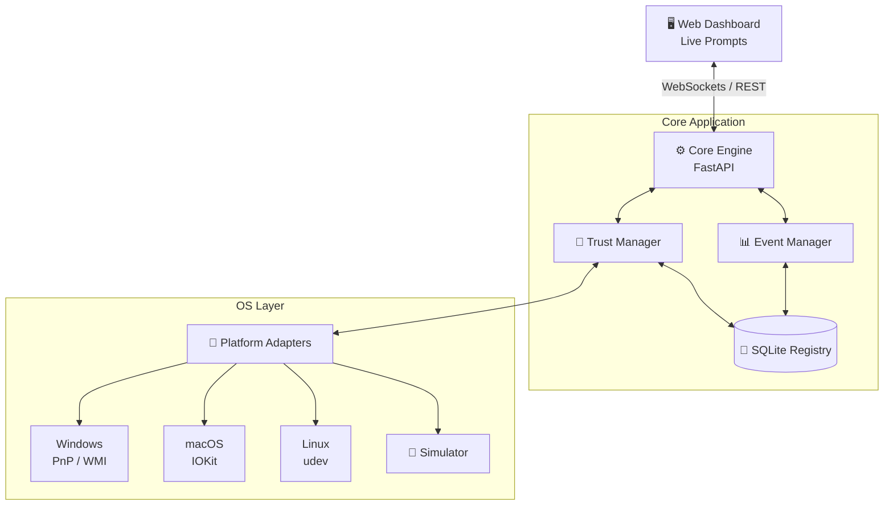

<div align="center">

# 🛡️ HID Authenticator 

**Peripheral Trust-Management Application** for USB Human Interface Devices (HIDs)

[](https://www.python.org/downloads/)
[](https://opensource.org/licenses/MIT)
[](https://github.com/psf/black)
[](https://fastapi.tiangolo.com/)

*Zero-trust peripheral security for your workstation.*

</div>

---

## 📖 Overview

When a USB keyboard, mouse, or other HID device is plugged into a workstation, the operating system routinely begins accepting input immediately without verifying whether the user recognizes or trusts that physical peripheral.

**HID Authenticator** solves this by providing a visible peripheral trust-management workflow. It detects connected devices, matches them against a trusted registry, and intercepts unrecognized peripherals for explicit user approval. 

## ✨ Key Features

- 🔍 **Real-time Detection:** Automatically detects connected USB Human Interface Devices (keyboards, mice, etc.).
- 🛡️ **Zero-Trust Registry:** Compares devices against a local persistent trusted-device registry.
- ⚡ **Explicit Approval:** Requests explicit user approval for unregistered devices before they are trusted.
- 📜 **Immutable Audit Trail:** Maintains an SQLite registry of approved devices and an audit history of all events.
- 🚦 **Cross-Platform Adapters:** Supports Windows (PnP/WMI), with skeleton implementations for Linux (udev) and macOS (IOKit).
- 🎮 **Built-in Simulator:** Includes an embedded Simulator Studio to test peripheral attacks and approval workflows safely.

---

## 🏗️ Architecture



---

## 🚦 Device Status Terminology

| Status | Meaning | Icon |
|:---|:---|:---:|
| **Not authenticated** | No approval has been recorded for the device. | ⚪ |
| **Pending authentication** | The device requires a user decision. | 🟡 |
| **Authenticated** | The user has approved the device and it is in the trusted registry. | 🟢 |
| **Rejected** | The user rejected the device; it does not become trusted. | 🔴 |
| **Trust revoked** | A previous approval has been withdrawn. Connecting again requires renewal. | 🛑 |

---

## ⚙️ Device Matching Rules

To prevent spoofing and ambiguous approvals, HID Authenticator uses a strict matching hierarchy:

1. 🥇 **Serial Number Match:** Strongest match, using a valid hardware serial number.
2. 🥈 **Hardware ID / Instance Path Match:** OS-specific physical instance path.
3. 🥉 **Descriptor Match:** VID + PID + Manufacturer + Product String + Interface Category.

> **Note:** The system will **never** silently trust a device solely based on a bare VID/PID match if other descriptors are missing or conflicting.

---

## 🚀 Quick Start

### 1. Prerequisites
- Python 3.10 or higher
- Windows, Linux, or macOS

### 2. Installation
Clone the repository and install the required dependencies:

```bash
git clone https://github.com/yourusername/hidauthenticator.git
cd hidauthenticator/hidauthenticator

# (Optional but recommended) Create a virtual environment
python -m venv .venv
source .venv/bin/activate  # On Windows use: .venv\Scripts\activate

# Install dependencies
pip install -r requirements.txt
```

### 3. Running the Application

Launch the FastAPI backend and real-time dashboard:

```bash
python run.py
```

Open your browser and navigate to:
```text
http://127.0.0.1:8000
```

---

## 🧪 Testing

The repository includes a comprehensive automated test suite that validates the database schema, matching rules, approval/rejection workflows, and duplicate notification suppression.

Run the tests with:
```bash
cd hidauthenticator
python -m unittest discover tests -v
```

---

## 📂 Project Structure

```text
📦 hidauthenticator
 ┣ 📂 adapters/         # OS-level hardware detection (Windows, Linux, macOS, Simulator)
 ┣ 📂 api/              # FastAPI REST endpoints & WebSocket server
 ┣ 📂 core/             # Business logic (Trust Manager, Event Logger, DB)
 ┣ 📂 static/           # Dashboard UI (HTML, CSS, JS)
 ┣ 📂 tests/            # Automated test suite
 ┣ 📜 run.py            # Application entry point
 ┗ 📜 requirements.txt  # Pinned Python dependencies
```

---

## ⚠️ Limitations & Non-Goals

- **Application-Level Trust:** Approving or rejecting a device records user intent in the application registry. It does **not** perform OS-level kernel/driver input blocking in this MVP.
- **No Suspicious Classification:** The product does not classify peripherals as "malware" or analyze keystroke timing/injection.

---

## 📄 License

This project is licensed under the MIT License - see the [LICENSE](LICENSE) file for details.
